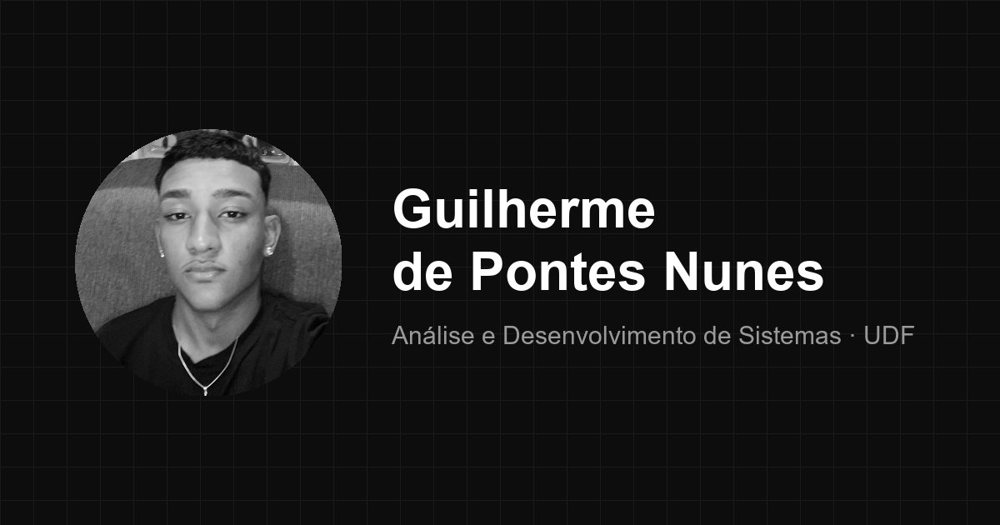

# Portfólio | Guilherme de Pontes Nunes



Portfólio acadêmico com os projetos que desenvolvi no curso de **Análise e Desenvolvimento de Sistemas** do **UDF Centro Universitário**.

**Site no ar:** https://guilhermenunes-jpn.github.io/portfolio/

## Seções

- **Início:** apresentação
- **Números:** semestres, disciplinas, projetos e tecnologias
- **Sobre mim:** quem sou e minhas habilidades
- **Projetos:** 7 trabalhos com filtro por área e janela de detalhes
- **Formação:** linha do tempo do curso
- **Contato:** LinkedIn, GitHub e e-mail

## Tecnologias

| Parte | O que foi usado |
|---|---|
| HTML | Tags semânticas, `dialog`, atributos de acessibilidade |
| CSS | Variáveis, Grid, Flexbox, media queries, animações, modo escuro com `prefers-color-scheme` |
| JavaScript | Filtro de projetos, troca de tema com `localStorage`, `IntersectionObserver` |
| Publicação | Git, GitHub e GitHub Pages |

## Estrutura

```
portfolio/
├── index.html       página principal
├── style.css        estilos e temas claro/escuro
├── script.js        interações
├── favicon.svg      ícone da aba
├── img/             foto, prints e imagem de compartilhamento
├── selecao/         site avaliativo da Seleção Brasileira
└── projetotech/     site avaliativo Eventos Tech Brasília 2026
```

## Como rodar no computador

1. Clone o repositório: `git clone https://github.com/guilhermenunes-jpn/portfolio.git`
2. Abra o arquivo `index.html` no navegador (ou use a extensão Live Server do VS Code).

## Contato

- LinkedIn: [Guilherme Pontes Nunes](https://www.linkedin.com/in/guilherme-p-nunes-687071430/)
- E-mail: guilhermepnunes359@gmail.com
